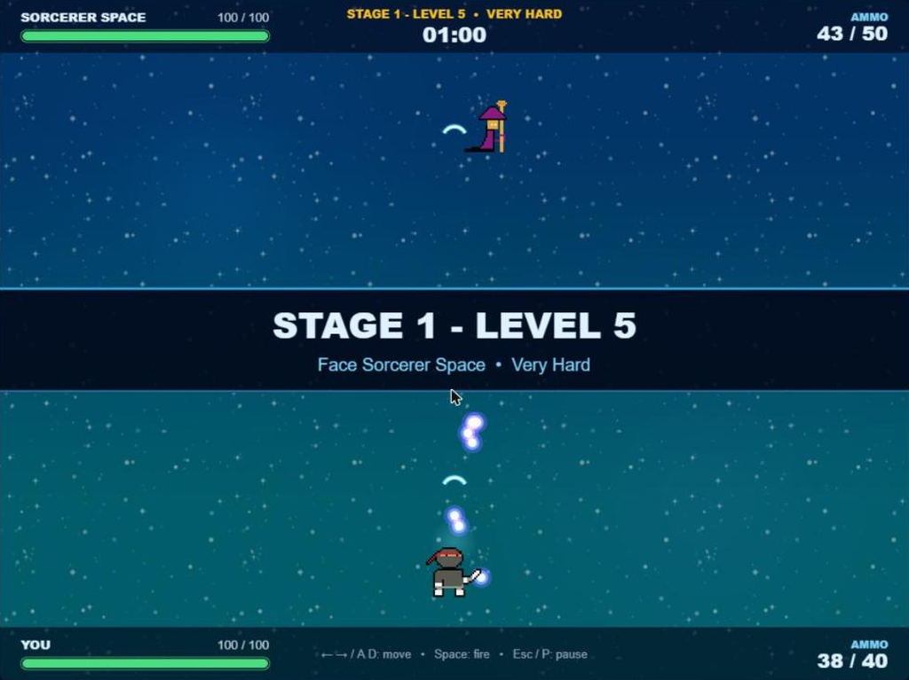

# Space Duel

A 2D arena duel playable in the browser. You pilot a fighter at the bottom of the screen and face **Sorcerer Space**, an AI-controlled opponent at the top. Move, dodge his magic orbs, manage your limited ammunition and bring his health down to zero before he does the same to you.

Built with **Phaser 3**, **TypeScript** and **Vite**.



## Features

- **Real-time duel**: horizontal movement only, manual fire, 100 HP for each fighter.
- **Limited ammunition**: a fixed reserve per fight, with no reloading.
- **Time limit**: each fight lasts at most one minute. When time runs out, or when both fighters are out of ammunition, the one with the most HP wins (a tie goes to the opponent).
- **Hybrid AI**: the opponent alternates attack and patrol phases, leads its shots, dodges incoming fire, keeps out of your line of fire between its shots and waits for gaps in your fire.
- **Campaign in stages**: each stage pits you against one opponent over 5 levels of increasing difficulty. Stage 1 is against Sorcerer Space; more stages are planned.
- **Progress saved locally**: continue where you left off, or replay any level you have won from the level select screen.
- **Skins**: several ships and characters to choose from. Skins are purely cosmetic and never change the stats.
- **Synthesized audio**: sound effects and music generated with the Web Audio API, with no audio files.

## Controls

| Action | Keys |
| --- | --- |
| Move | ← → or A / D |
| Fire | Space |
| Pause | Esc or P |

## Getting started

[Node.js](https://nodejs.org) is required.

```bash
npm install
npm run dev-nolog
```

Then open http://localhost:8080.

| Command | Description |
| --- | --- |
| `npm run dev-nolog` | Start the development server on port 8080 |
| `npm run build-nolog` | Build the production version into `dist/` |
| `npx tsc --noEmit` | Run the TypeScript type check (the build alone does not check types) |

`npm run dev` and `npm run build` do the same, but first run `log.js`, a script inherited from the Phaser template that sends an anonymous usage ping to Phaser Studio. The `-nolog` variants skip it.

## Project structure

```text
src/game/
├── ai/          AI controller and decision logic of the opponent
├── config/      Phaser configuration and shared constants
├── data/        Characters, projectiles, AI settings, campaign stages and levels, skins
├── entities/    Fighters (player and enemy) and projectiles
├── modes/       Game mode contract and the Campaign mode
├── scenes/      Phaser scenes: menus, duel, pause, settings, result screens
├── systems/     Combat, health, ammunition, audio, save and skin management
└── ui/          HUD, health bars, buttons, effects and backgrounds
```

Gameplay values (health, speed, ammunition, damage, AI behavior, level difficulty) live in `src/game/data/`, so the game can be balanced without touching the systems.

Design documents:

- [`docs/GAME_SPEC.md`](docs/GAME_SPEC.md): game design and gameplay rules.
- [`CLAUDE.md`](CLAUDE.md): development guidelines.

## Adding a skin

Skins are drawn in pixel art on square frames, using the templates in [`docs/sprite-templates/`](docs/sprite-templates/README.md). Put the PNG sheet in `public/assets/` and add an entry to `SKINS` in `src/game/data/skins.ts`:

```ts
{
  ...createStripVisual("my-skin", {
    path: "my-skin.png",
    frameSize: 32,
    idle: [1, 2, 3],   // frames looped while idle
    fire: 4,           // optional frame shown on each shot
    frameRate: 10,
  }),
  name: "My Skin",
  description: "A short description.",
  type: "vehicle",
  accentColor: "#38bdf8",
}
```

## License

[MIT](LICENSE)
